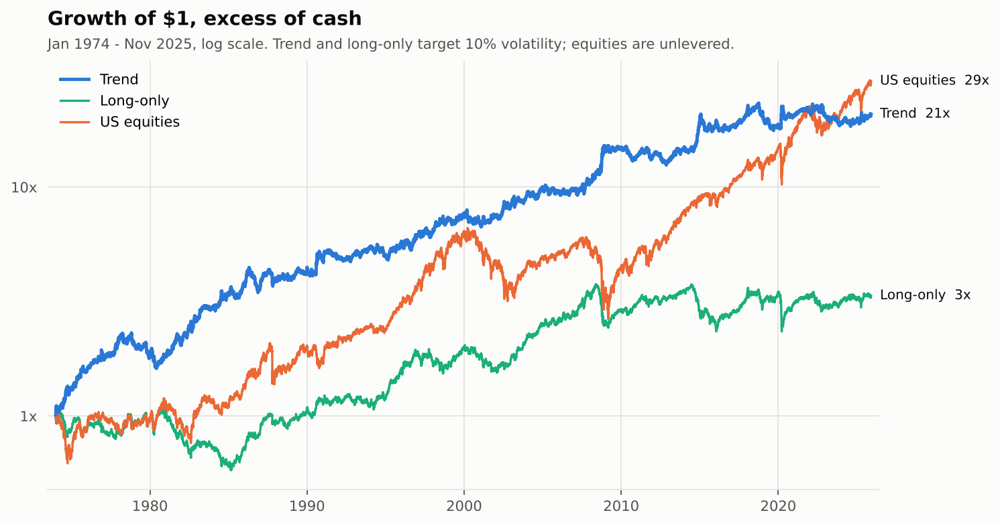
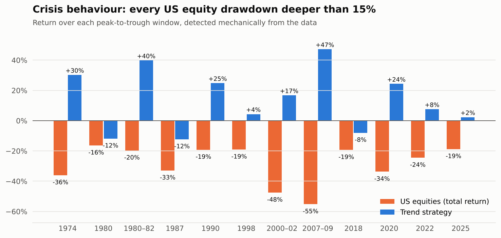
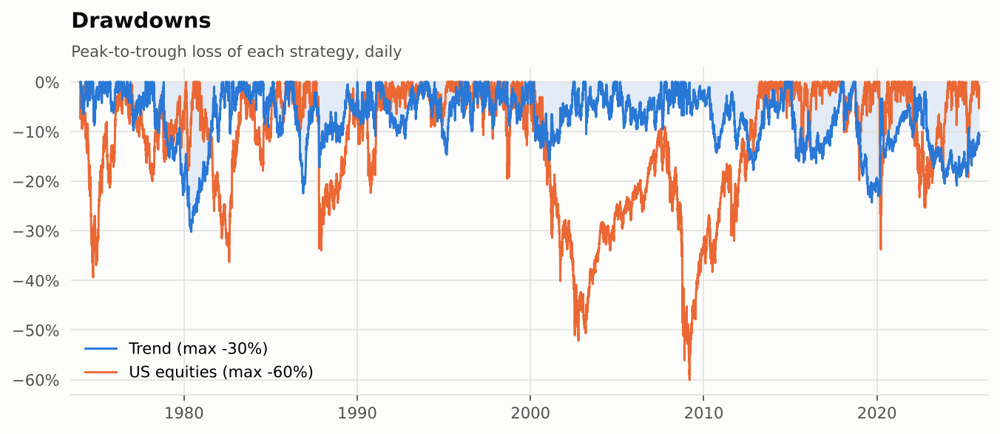
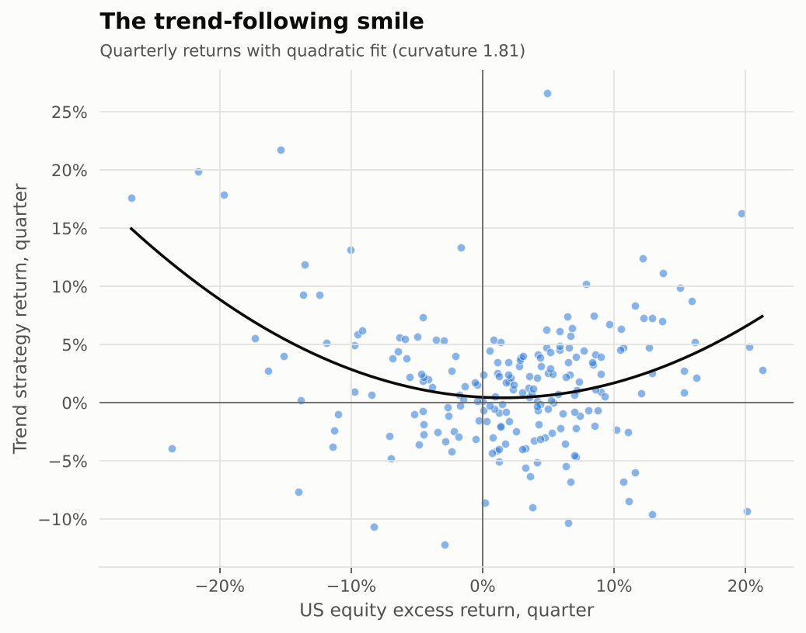
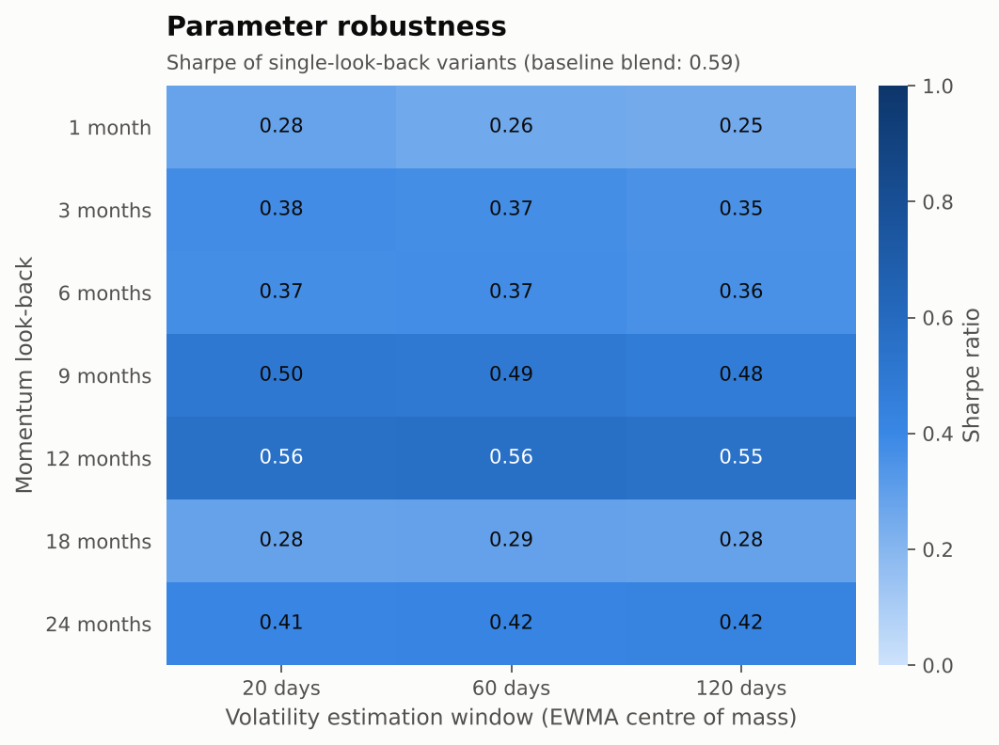
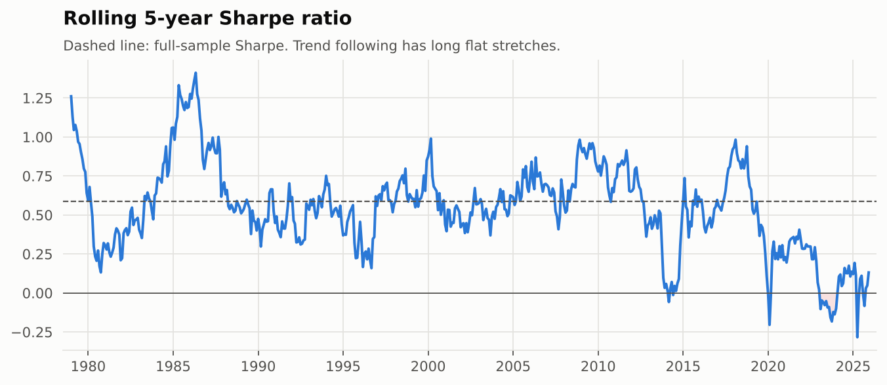
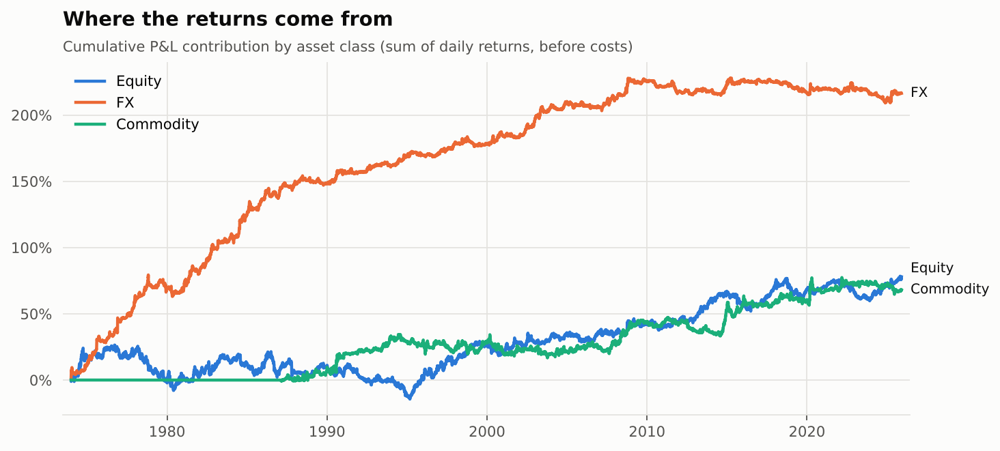
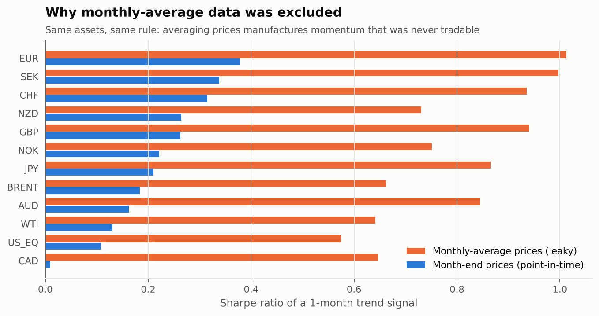

# Cross-Asset Trend Following: 50 Years, Point-in-Time


A research-grade backtest of **time-series momentum** (the core strategy of managed-futures / CTA funds) across US equities, nine major currencies and crude oil, **January 1974 – November 2025**. The focus is not on finding the best-looking equity curve, but on answering the question a risk committee would ask: *is this real, and would it have survived contact with the market?*



## Key results

| | Trend (net of costs) | Long-only, same risk budgets | US equities |
|---|---:|---:|---:|
| Annual excess return | **6.4%** | 3.0% | 7.7% |
| Volatility | 11.0% | 11.3% | 15.3% |
| **Sharpe ratio** | **0.59** | 0.26 | 0.50 |
| Max drawdown | **−30%** | −46% | −60% |
| Monthly skewness | **+0.45** | −0.64 | −0.44 |
| Correlation with US equities | **−0.09** | 0.68 | 1.00 |

- **Statistically robust:** Newey-West t-stat 4.5, bootstrap 95% CI for the Sharpe ratio [0.34, 0.85], **Deflated Sharpe Ratio 0.995** after accounting for all 32 variants tested.
- **Crisis alpha:** positive in **9 of the 12** US equity drawdowns deeper than 15% since 1974, including +47% in 2007–09 and +24% in the 2020 COVID crash.
- **Not overfit:** a walk-forward procedure that re-selects parameters every year using only past data earns an out-of-sample Sharpe of 0.51, versus 0.47 for the fixed baseline – parameter choice barely matters.
- **Honest about decay:** Sharpe was 0.6–0.9 in every decade up to 2009, but only ~0.25 since 2010.

## 1. Research question

Trend following is one of the best-documented anomalies in finance ([Moskowitz, Ooi & Pedersen, 2012](#references); [Hurst, Ooi & Pedersen, 2017](#references)). This project rebuilds it from scratch on free data with three goals:

1. Use **only information available at the time** of every decision.
2. Separate the value of **timing** (the trend signal) from the value of simply **holding a diversified, risk-balanced portfolio**.
3. Quantify how much of the result could be **luck or data mining**.

## 2. Data

| Asset class | Markets | Source | Daily data from |
|---|---|---|---|
| Equity | US equities, total return minus T-bill return | [SteelCerberus/us-market-data](https://github.com/SteelCerberus/us-market-data) (MIT) | 1971 |
| FX | AUD, CAD, CHF, EUR, GBP, JPY, NOK, NZD, SEK vs USD | Federal Reserve H.10 via [datasets/exchange-rates](https://github.com/datasets/exchange-rates) | 1971 (EUR 1999) |
| Commodity | WTI and Brent crude oil | U.S. EIA via [datasets/oil-prices](https://github.com/datasets/oil-prices) | 1986 / 1987 |

Point-in-time rules, all enforced in [`data.py`](src/trendlab/data.py):

- **Only daily closing prices are used.** Gold and Treasury yields are freely available only as *monthly averages*, so they were excluded on purpose (see [section 6](#6-data-integrity-experiment-why-averaged-prices-were-excluded)).
- Each series is converted to returns on **its own trading calendar** before alignment, so a move during a local holiday is booked on the next trading day, never earlier.
- A non-positive price (WTI spot on 20 April 2020) is treated as a missing observation.
- **Tradability filter:** a market is skipped if its volatility is below 1% or if more than half of the last 63 days had no price change. This removes pegged currencies (AUD and NZD in the early 1970s) that would otherwise receive huge leverage right before a devaluation.
- Trading starts in **January 1974**, after fixed exchange rates (Bretton Woods / Smithsonian) ended in March 1973. Data from 1971 is used only to warm up signals and risk estimates.

A full data-quality report is in [`data/processed/data_quality_report.csv`](data/processed/data_quality_report.csv).

## 3. Methodology

**Signal.** At each month-end, for every market, the baseline averages the sign of the past 1-, 3- and 12-month excess return (Hurst, Ooi & Pedersen, 2017):

```
s_i = ( sign(r_i,1m) + sign(r_i,3m) + sign(r_i,12m) ) / 3        ∈ {−1, −⅓, +⅓, +1}
```

The baseline was **fixed from the literature before looking at results**. It is not the best variant on this data set: it ranks 4th of the 32 variants tested, and the best one (a risk-scaled 12-month signal) reaches a Sharpe of 0.64. Reporting the pre-committed baseline instead of the winner avoids selection bias (see [robustness](#parameter-robustness)).

**Position sizing.**

1. Each asset class (equity, FX, commodity) gets **one third of the risk budget**, split equally across its tradable markets.
2. Within its budget, a position is inversely proportional to the market's **ex-ante EWMA volatility** (60-day centre of mass).
3. The whole book is scaled to **10% annual volatility** using an EWMA covariance matrix (126-day half-life), with caps of 2× notional per market and 5× gross leverage.

**Execution and costs.**

- Signals, volatilities and covariances use data up to the close of the rebalance day. Trades happen at that close, and the new positions **earn returns from the next day**.
- Between rebalances, positions **drift with prices**, and costs are paid on the difference between the drifted and the new positions.
- One-way costs are 3 bp per unit of notional for equity and FX and 10 bp for crude oil – conservative compared with liquid futures and forwards.
- Average turnover is 15× capital a year, giving a cost drag of 0.56% a year.

**Benchmark.** The *long-only, same risk budgets* portfolio uses identical machinery but is always long. The difference between it and the trend strategy is the value of the trend signal itself.

## 4. Results

### Crisis behaviour

Every US equity drawdown deeper than 15% was **detected automatically** from the data – no hand-picked crises:



The three losing episodes – the early-1980 sell-off, the **1987 crash** (−12%) and Q4 2018 (−8%) – were all short, sharp falls lasting between six weeks and three months, with no prior downtrend for the signal to pick up. Speed alone is not fatal, though: the 2020 crash was even faster, yet the strategy made +24% because it was already short crude oil (+15 points of the gain) and short commodity currencies such as AUD, CAD and NOK (+7 points), while its equity position contributed roughly nothing. Trend following reliably helps in slow, grinding bear markets (1974, 2000–02, 2007–09) and is weakest when a crash comes out of a calm uptrend.

| Drawdowns | The "smile" |
|---|---|
|  |  |

The quarterly returns form the classic **trend-following smile**: the strategy tends to make money in both very bad and very good quarters for equities, which is why its return distribution is **positively skewed** (+0.45), while equities are negatively skewed (−0.44).

## 5. Is the Sharpe ratio real?

| Test | Result | Interpretation |
|---|---|---|
| Newey-West t-stat of mean return (12 lags) | **4.47** (p < 0.0001) | Robust to autocorrelation and heteroskedasticity |
| Probabilistic Sharpe Ratio, P(SR > 0) | **> 0.999** | Adjusts for skew, fat tails and sample length |
| Deflated Sharpe Ratio, 32 trials | **0.995** | The best of 32 *unskilled* variants would score ~0.24; we observe 0.59 |
| Stationary bootstrap, 95% CI of Sharpe | **[0.34, 0.85]** | 5,000 resamples, mean block of 6 months |
| Alpha vs US equities | **6.9% a year** (t = 4.2), beta −0.06 | Return is not disguised equity exposure |
| Alpha vs long-only portfolio | **6.7% a year** (t = 4.4) | The value comes from timing, not from the asset mix |

### Walk-forward selection

Every January from 1985, the configuration with the best Sharpe on all **prior** data (out of the 32) is selected and traded for the next 12 months. The stitched out-of-sample track record has a **Sharpe of 0.51**, versus 0.47 for the fixed baseline over the same period. Choosing parameters with hindsight adds almost nothing, which is what you want to see. Selection log: [`results/tables/walk_forward_selection.csv`](results/tables/walk_forward_selection.csv).

### Parameter robustness



All 32 variants tested have a positive Sharpe ratio (0.25–0.64); the heatmap shows the 21 single-look-back ones. The volatility window is almost irrelevant, and 9–12 month look-backs work best, consistent with the literature. The full list is in [`results/tables/all_trials.csv`](results/tables/all_trials.csv).

### Transaction costs

| Cost level | 0× | 1× (baseline) | 2× | 5× | 10× |
|---|---:|---:|---:|---:|---:|
| Sharpe ratio | 0.64 | **0.59** | 0.54 | 0.38 | 0.13 |
| Annual cost drag | 0.0% | 0.6% | 1.1% | 2.8% | 5.6% |

The strategy survives costs five times higher than assumed. At ten times, most of the edge is gone.

### How the edge changed over time

| Decade | 1974–79 | 1980s | 1990s | 2000s | 2010s | 2020–25 |
|---|---:|---:|---:|---:|---:|---:|
| Trend Sharpe | 0.87 | 0.78 | 0.63 | 0.70 | **0.27** | **0.22** |
| US equities Sharpe | 0.05 | 0.53 | 0.95 | −0.15 | 1.03 | 0.75 |





Most of the historical profit came from **currency trends**, which have been almost flat since 2009. Plausible explanations include near-zero interest rates and central-bank intervention compressing currency trends, and more capital chasing the same signal – but this backtest **cannot distinguish between them**. The weak 2010s are consistent with what the managed-futures industry experienced.

## 6. Data-integrity experiment: why averaged prices were excluded

Many free datasets publish **monthly averages** instead of month-end prices. The "return" between two monthly averages overlaps with the second half of the month in which the signal is formed – part of it is **already known when you trade**. Working (1960) showed that this alone creates ~0.25 autocorrelation in a pure random walk.

The experiment applies the same 1-month trend rule to the **same 12 markets**, using month-end prices versus monthly averages:

| Price series | Lag-1 autocorrelation | Sharpe of 1-month trend |
|---|---:|---:|
| Month-end closes (tradable) | 0.04 | 0.22 |
| Monthly averages (leaky) | **0.30** | **0.80** |



Using averaged data would have **almost quadrupled** the Sharpe ratio of a rule that is barely profitable in reality. This is why gold and Treasury bonds are not in the universe, even though they would make it more diversified.

## 7. Limitations

- **Spot prices, not futures or forwards.** FX returns exclude the interest-rate differential (carry), and oil returns exclude roll yield. A real implementation would trade futures and forwards, whose returns can differ materially.
- **Narrow universe:** one equity market, no bonds, no metals or agriculture. Professional CTAs trade 50–150 markets, which typically gives a higher Sharpe through diversification.
- **The trial count is a lower bound.** The Deflated Sharpe Ratio counts the 32 variants in the parameter grid, but not every decision made during research (universe, start date, cost levels).
- **The start date is a judgment call.** Starting in 1972 instead of 1974 gives almost the same Sharpe (0.60), but adds a +29% month during the collapse of fixed exchange rates (February 1973) and raises excess kurtosis from 2.8 to 9.5. The later, more conservative start is reported as the baseline.
- **Volatility targeting is imperfect:** realised volatility was 11.0% versus the 10% target, because EWMA estimates lag sudden volatility spikes.
- **Simple cost model:** no market impact, capacity limits, financing spreads or management fees.

## Project structure

```
src/trendlab/
  config.py       universe, data sources, costs and strategy parameters
  data.py         download and point-in-time return construction, data-quality checks
  signals.py      time-series momentum signals
  risk.py         EWMA volatility and covariance
  portfolio.py    risk budgeting, volatility targeting, tradability filter, limits
  backtest.py     daily engine: execution lag, position drift, transaction costs
  metrics.py      performance statistics
  stats.py        Newey-West, PSR, Deflated Sharpe, stationary bootstrap, alpha/beta
  analysis.py     parameter grid, walk-forward, crisis episodes, averaging-bias experiment
  plotting.py     figures
scripts/
  build_dataset.py   downloads raw data and builds data/processed/
  run_research.py    runs everything and writes results/
tests/            15 unit tests, run on every push by GitHub Actions
results/          figures, tables (CSV) and metrics.json
```

## Reproduce

```bash
pip install -r requirements.txt
python scripts/build_dataset.py      # optional: rebuild data from the public sources
python scripts/run_research.py       # ~1-2 minutes, writes results/
pytest -q                            # 15 tests
```

The processed dataset is committed, so `run_research.py` works without downloading anything.

### What the tests check

- **No look-ahead:** replacing all future returns with random noise does not change a single past position or past return.
- **Execution timing:** a price jump on a rebalance day is earned by the *old* position, and the new position starts earning on the next day.
- **Risk targeting:** realised volatility is close to the target.
- **Costs:** they are charged exactly on traded notional, and gross returns are unaffected.
- **Leverage limits and the tradability filter** are respected.
- **Statistics:** PSR equals 0.5 at its own Sharpe, the expected maximum Sharpe grows with the number of trials, and averaging a random walk creates ~0.25 autocorrelation.

## References

- Moskowitz, T., Ooi, Y. H. & Pedersen, L. H. (2012). Time series momentum. *Journal of Financial Economics*, 104(2).
- Hurst, B., Ooi, Y. H. & Pedersen, L. H. (2017). A century of evidence on trend-following investing. *Journal of Portfolio Management*, 44(1).
- Bailey, D. & López de Prado, M. (2014). The deflated Sharpe ratio. *Journal of Portfolio Management*, 40(5).
- Bailey, D. & López de Prado, M. (2012). The Sharpe ratio efficient frontier. *Journal of Risk*, 15(2).
- Politis, D. & Romano, J. (1994). The stationary bootstrap. *Journal of the American Statistical Association*, 89(428).
- Newey, W. & West, K. (1987). A simple, positive semi-definite, heteroskedasticity and autocorrelation consistent covariance matrix. *Econometrica*, 55(3).
- Working, H. (1960). Note on the correlation of first differences of averages in a random chain. *Econometrica*, 28(4).

## Author

**Marcin Ossoliński** – Data Engineering student, Rzeszów University of Technology · [GitHub](https://github.com/marcinossolinski)

*This is a research project, not investment advice.*
